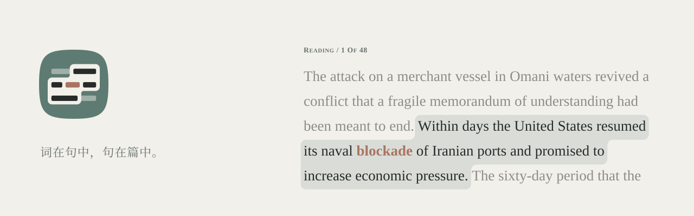
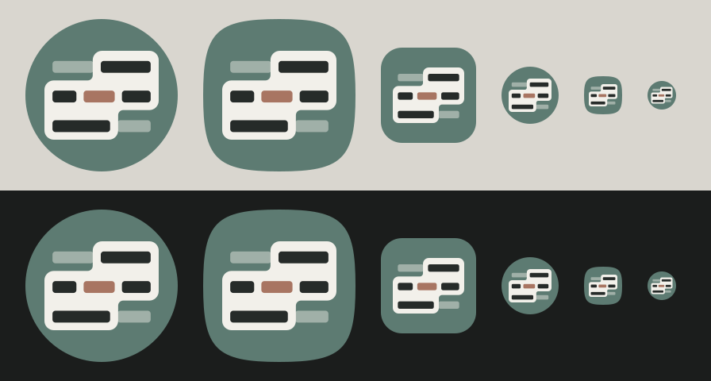
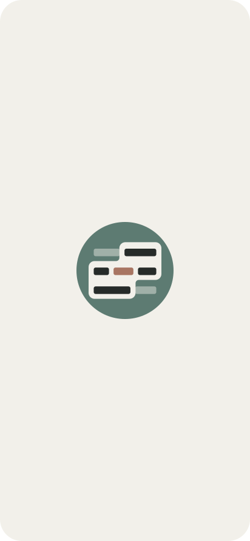
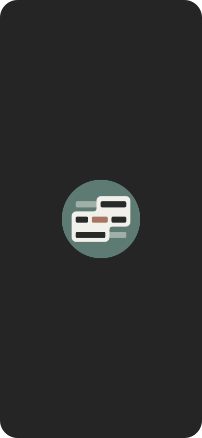
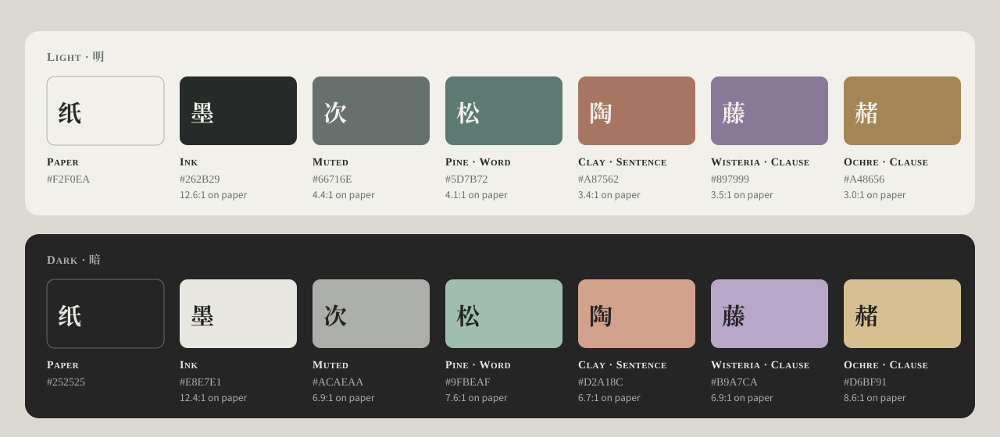
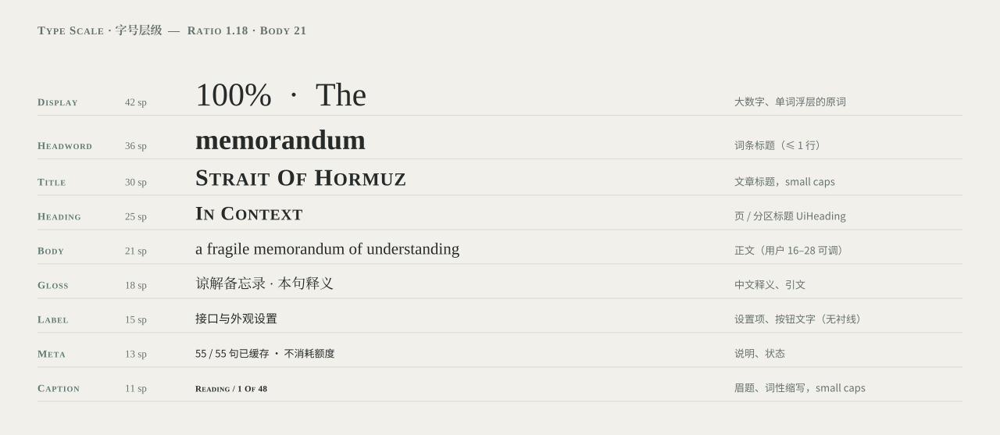
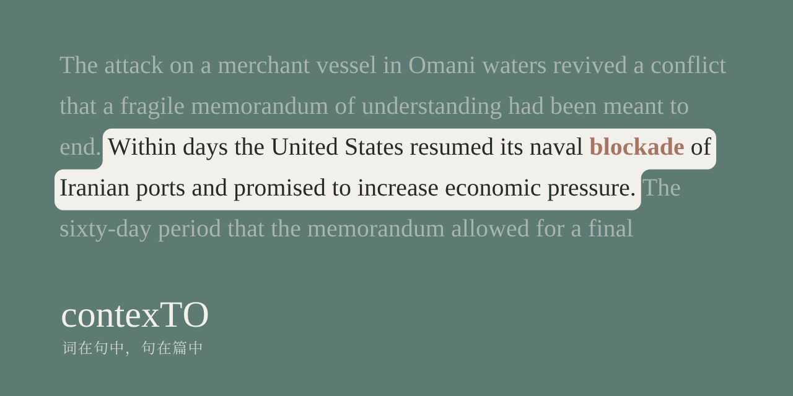
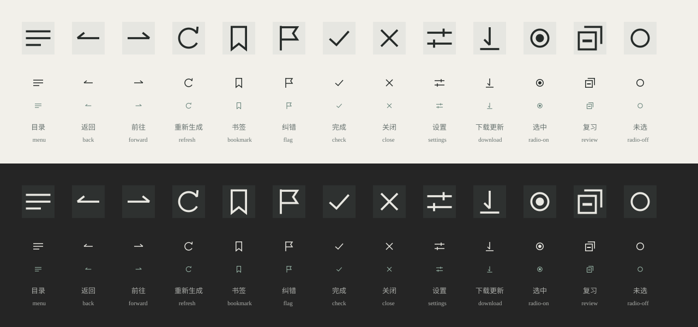

# contexTO · 美术与品牌规范

  

**词在句中，句在篇中。** 这套规范不另起一种风格，而是把阅读页已有的视觉语言整理成一个系统：Tinos 衬线正文、每词首字母全高的 small caps 标题、低饱和的纸 / 墨 / 松绿 / 陶土，以及沿句子逐行包裹的「跟随书签」轮廓。图标、宣传图和界面字形都从这几样东西里长出来。

所有资产由 [`tools/brand/build_brand.py`](../tools/brand/build_brand.py) 从同一份几何与调色板生成；文字全部转为轮廓，任何 SVG 渲染器结果一致。

## 1. 应用图标

  

图标就是阅读页的一个局部：三行文字，其中一句从第一行中间开始、在第三行中间结束，被书签轮廓整句包住；句中一个词刚被查过，显示为陶土色。轮廓的阶梯形状是这个应用独有的界面元素，缩到 32 px 仍可辨认。

| 层 | 内容 | 颜色 |
|---|---|---|
| 背景 `@color/ic_launcher_background` | 满版松绿 | `#5D7B72` |
| 前景 `ic_launcher_foreground` | 书签轮廓（纸）、句内词（墨）、句外词（纸 45%）、被查的词（陶土） | `#F2F0EA` `#262B29` `#A0B0A8`* `#A87562` |
| 单色 `ic_launcher_monochrome` | Android 13+ 主题图标：轮廓为实，句内词镂空，句外词 50% | 仅 alpha |

\* 纸色 45% 叠在松绿上的视觉结果。

构造（108 dp 自适应画布）：

- 文字行距 14，词条高 5.6，词间距 3.4；轮廓左右 27–81，顶 33，三行共 42 高，几何中心在 (54, 54)。
- 外角半径 4.4，内凹角 2.4，与阅读页书签「首尾行缺角平滑变形」的处理一致。
- 内容落在 66 dp 安全圆内（轮廓圆角后的最远点约 32 dp），各家遮罩都不会裁到词条。
- 不加阴影、不加渐变、不加描边，与[策划案第 5 节](../PRODUCT_PLAN.md)「纯色、无描边、无厚重阴影」一致。

minSdk 为 31，所以只提供 `mipmap-anydpi` 的自适应图标，不需要逐密度 PNG。Play 商店用的 512 px 方图见 [`brand/icon-play-512.png`](brand/icon-play-512.png)。

## 2. 启动画面

  
  

Android 12+ 的系统启动画面使用上面的图标，背景取 `@color/contexto_paper`：系统明色时为纸色 `#F2F0EA`，系统暗色时为 `#252525`，与 `palette()` 的两种底色完全相同，不再是 Material Light 的默认浅色底。`android:windowBackground` 也指向同一颜色，Compose 首帧之前的窗口底色与应用一致。

限制：应用自己的「深色主题」设置存在 SharedPreferences 里，进程启动前系统读不到，所以启动画面跟随**系统**明暗。默认 `dark = true` 而系统为明色时，会先看到纸色启动画面，再进入暗色阅读页。

## 3. 名称

品牌名写作 **contexTO**。本规范不设文字标志：图标是唯一的标志，名称出现时按正文排成普通文字（Tinos Regular，保持原有大小写，不做 small caps、不加粗、不改字距）。README 横幅不写名称，由紧随其后的标题承担。

## 4. 色彩

  

调色板与 `MainActivity.kt` 中的 `palette()` 完全一致，本 PR 没有改动任何界面颜色。品牌层面的角色分配：

| 角色 | 用途 |
|---|---|
| 松 Pine | 品牌底色（图标、社交预览）；界面中为可点按的「词」与链接色 |
| 纸 / 墨 | 页面与正文；图标里纸就是被书签包住的那一句 |
| 陶 Clay | 唯一的强调：一张图里只出现一次，标出「正在看的那个词」；界面中为句 / 段统计 |
| 藤 / 赭 | 只用于从句着色，不进入品牌图形 |

**对比度提示（未改动，留待决定）：** 明色主题下，松绿、陶土、藤紫、赭黄作为小字时低于 WCAG AA 的 4.5:1（见上图）。如需达标，可在同一色相上降低明度，例如：

| 角色 | 现值 | 对纸 | 达标候选 | 对纸 |
|---|---|---:|---|---:|
| muted | `#66716E` | 4.44 | `#65706D` | 4.50 |
| word | `#5D7B72` | 4.06 | `#56726A` | 4.59 |
| paragraph | `#A87562` | 3.42 | `#916250` | 4.53 |
| purple | `#897999` | 3.50 | `#776787` | 4.52 |
| gold | `#A48656` | 3.01 | `#816944` | 4.56 |

暗色主题各色对 `#252525` 均在 6.7:1 以上。

## 5. 字体

  

| 字族 | 用于 | 来源 |
|---|---|---|
| Tinos Regular / Bold | 英文正文、标题、small caps 眉题、名称 | 随 APK（OFL），与 Times New Roman 版心兼容 |
| 系统 Serif（中文） | 中文释义、句子翻译 | AOSP 字体配置中回落到 Noto Serif CJK |
| 系统 Sans | 设置项、状态、按钮文字 | Roboto / Noto Sans CJK |

**字号层级。** 以正文 21 sp 为锚、约 1.18 倍递进：11 · 13 · 15 · 18 · 21 · 25 · 30 · 36 · 42。现有界面已经用到其中的 11 / 13 / 15 / 21 / 25 / 30 / 42；目前代码里共有 20 种字号，建议逐步收敛到这 9 级：

| 现有 sp | 收敛到 | 角色 |
|---|---|---|
| 9 · 10 · 11 | 11 Caption | small caps 眉题、词性缩写、计数 |
| 12 · 13 | 13 Meta | 说明、状态（无衬线） |
| 14 · 15 · 16 | 15 Label | 设置项、按钮（无衬线） |
| 17 · 18 · 19 | 18 Gloss | 中文释义、引文、顶栏标题 |
| 20 · 21 · 22 | 21 Body | 正文（用户 16–28 可调，不受此表约束） |
| 23 · 25 · 27 | 25 Heading | 页 / 分区标题 `UiHeading` |
| 30 · 32 | 30 Title | 文章标题 |
| — | 36 Headword | 词条标题 |
| 42 | 42 Display | 大数字、单词浮层原词 |

这只是建议，本 PR 不改任何字号。

**排版规则。**

- small caps 只作用于拉丁字母；中文不加字距、不做伪粗体。
- 中英混排时，中文释义比同级英文小一级（如英文 21 配中文 18），视觉字重才平衡。
- 数字用 Tinos（等高数字）；百分比、计数和时间可以用到 Display 级，但不加粗。
- 部分国产 ROM 没有中文衬线字体，`FontFamily.Serif` 的中文会回落成黑体。若要在所有机型上保证宋体释义，需要随 APK 附带 Noto Serif SC 子集（按常用 3,000 字子集估计每个字重约 2 MB）。本 PR 没有这样做，也未在真机上核实回落情况。

## 6. 图形层级

| 层级 | 资产 | 状态 |
|---|---|---|
| L0 系统 | 启动器图标（自适应 + 单色主题图标）、启动画面 | **已接入**（本 PR） |
| L1 界面 | 书签轮廓、全页磨砂、界面字形 | 轮廓与磨砂沿用现状；字形为提案，见第 7 节 |
| L2 内容 | 从句四色、词库标识 | 沿用现状 |
| L3 传播 | README 横幅（明 / 暗）、GitHub 社交预览、商店特色图、512 图标 | 已生成，见下 |

  

社交预览与商店特色图把图标「放大到能读出字」：图标里的三行词条就是 N01 正文，书签包住的是第二句，陶土色的是 *blockade*。社交预览需要仓库管理员在 **Settings → General → Social preview** 手动上传 [`brand/social-preview.png`](brand/social-preview.png)；特色图 [`brand/feature-graphic.png`](brand/feature-graphic.png) 为 Play 规定的 1024×500。

## 7. 界面字形（提案，未接入）

  

目前界面里的 `≡` `↻` `⚑` `●` `○` `✓` 是系统字体中的字符，粗细和字形随机型变化，和 Tinos 的笔画不协调。这套字形按以下规则绘制，可以一一替换：

- 24 dp 网格，1.5 dp 线宽，平头端点、尖角连接，与正文字重相当。
- 箭头只画上半支箭羽，与现有 `JumpLink` 的下划线箭头同一做法。
- 只用 `ink` / `word` 着色，不填充底板。

单个 SVG 在 [`brand/glyphs/`](brand/glyphs/)。接入需要把 `Text("≡")` 等换成 `Icon(painterResource(...))`，同时保留 `testTag` 与点按区域。这会改动交互代码，所以留给后续 PR，等确认方向后再做。

## 8. 资产清单

| 文件 | 用途 |
|---|---|
| `app/src/main/res/mipmap-anydpi/ic_launcher*.xml` | 自适应图标 |
| `app/src/main/res/drawable/ic_launcher_{foreground,monochrome}.xml` | 图标前景 / 单色层 |
| `app/src/main/res/values{,-night}/colors.xml`、`values/themes.xml` | 启动画面与窗口底色 |
| `docs/brand/icon*.svg`、`icon-play-512.png` | 图标母版与商店图 |
| `docs/brand/banner-*.svg` | README 横幅（随 GitHub 明暗切换） |
| `docs/brand/social-preview.png`、`feature-graphic.png` | 传播图 |
| `docs/brand/palette.svg`、`type-scale-*.svg`、`glyphs.svg`、`glyphs/*.svg` | 规范图与字形 |

重新生成见 [`tools/brand/README.md`](../tools/brand/README.md)。
