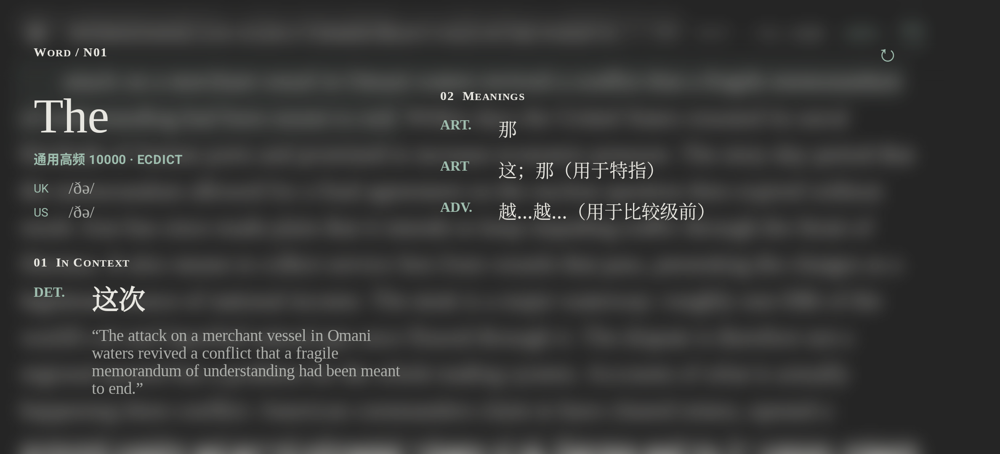
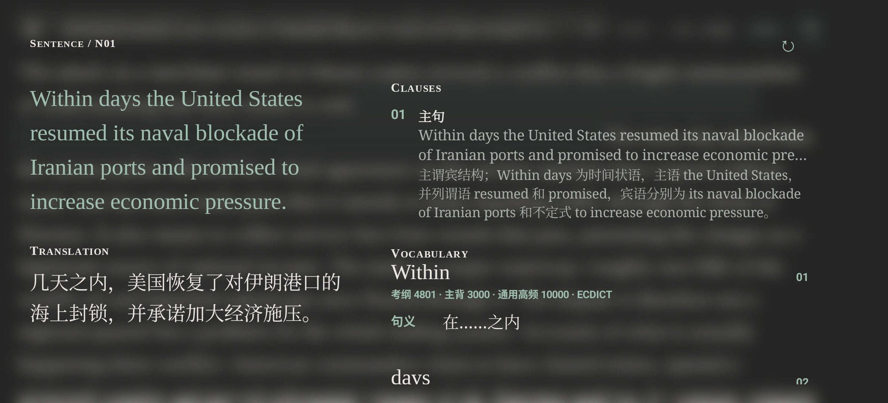
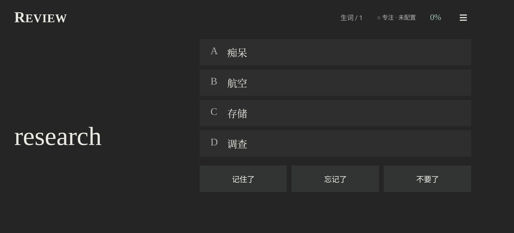
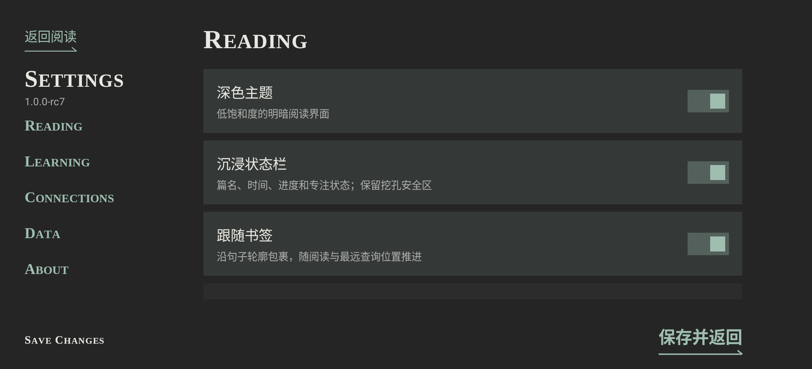

# 横屏兼容：窗口版式、旋转与交互

本 PR 面向横屏和可变尺寸窗口，保留四面板的既有层级、全页磨砂、色彩与字体体系。没有新增手动横屏开关，没有更新版本号、打标签或发布 Release，等待独立审查。

## 版式原则

- 阅读是一张连续的单栏画布；横屏顶栏合为一行，正文完整标题保留，超宽窗口限制最大行长，用户设置的字号、行距与边距仍有效。
- 解析是一张共用标题栏的双区画布：左侧原词 / 原句、音标与当前释义，右侧通用义项、从句、派生词或出现记录。顶栏动作位于整个浮层右上角；两区独立滚动，均无额外底板。普通纵向窗口仍为连续单列。
- 复习左侧只展示题词，右侧集中四个选项与三个自评按钮；目录和单词列表在有空间时按行优先展示两列，不改变顺序。词库的概况和活动 / 管理按角色分区，热度图不盲目撑大。
- 设置采用分类导航与单个表单区域，固定底部磨砂保存栏；输入法出现时仍可保存。引导与导入 / 数据 / 下载工具复用同一分区规则。
- 所有决定来自消耗安全区后的实际窗口宽高，不依赖设备型号、固定像素或单一 orientation 标志。两列需至少 600 个字体缩放后的 dp；大字号和窄窗口退回单列，不压缩可读字号。

## 旋转与动画

1. Activity 仅自行处理方向与窗口大小相关的配置更新，Compose 根据新约束重排；不以重启界面代替适配。其他配置更新、进程死亡不在此机制保证范围内。
2. 面板、当前题目、评分、设置草稿和查询观察者留在同一界面实例中。旋转不是重新查询，不修改数据库结构、解析键、提供商或预置数据。
3. 阅读在尺寸变化前捕获顶部可见字符，等待新文本布局完成后恢复到该字符所在行。恢复期间暂停自动推进书签，避免因换行改变而误记阅读进度。
4. 词和句子的源字形使用最新布局坐标。统一将根坐标转换为安全区内的浮层坐标，左右挖孔不会让飞行动画横向错位；重排不重复播放打开动画。
5. 双列 / 单列切换使用 movable content 保留展开项。逐字几何跟踪只开启在当前交互的原文上，不在普通滚动 / 拖动时扫描整篇文章。

主要入口：`AdaptiveLayout.kt`（版式与分区）、`MainActivity.kt`（安全区、阅读锚点、坐标及浮层）、`StudyPage.kt`（复习 / 列表 / 词库）、`SettingsPage.kt` 与 `ImportAndGuide.kt`。

依据：[Android 配置变化](https://developer.android.com/guide/topics/resources/runtime-changes)、[Compose 安全区及消费](https://developer.android.com/develop/ui/compose/system/insets-ui)。这里只接管尺寸变化，不禁用其他配置变化的标准生命周期。

## 验证与复现

本地最终验证：

- 57 项 JVM 单元测试通过，含 3 项窗口边界与大字号回落测试。
- 35 项 Android 设备测试通过，含 7 组新增 Compose UI 测试：词 / 非首句及嵌套查词、设置草稿、题目及评分、引导、大字号回落、词库 / 菜单，以及明色原生状态栏下的任务页；均覆盖旋转。
- `testDebugUnitTest assembleDebug assembleDebugAndroidTest lintDebug` 构建通过。Lint 为 0 errors、40 warnings、8 hints；不把既有提示记为零告警。
- `tools/validate_presets.py` 验证通过：10,000 个词元、120 个句子、2,582 个出现记录；文章 / 解析 ZIP 边界不变。源码密钥模式检查与 `git diff --check` 通过。

设备测试使用 API 35 的 Android 模拟器，参考显示区域为 1080 × 2376、密度 440 dpi。UI 测试使用独立数据库和偏好设置、离线预置解析及拒绝联网的模型传输，不写用户库，也不消耗模型额度。测试结束已关闭模拟器，并核实无 QEMU 残留。

测试验证了文本框编辑、旋转后草稿保留及保存可达；本轮编辑截图未显示软键盘覆盖，尚未验证真实软键盘遮挡。物理挖孔、不同导航方式和帧率仍需真机复核，截图不作为流畅度测量。

```powershell
.\gradlew.bat testDebugUnitTest assembleDebug assembleDebugAndroidTest lintDebug
adb -s emulator-5554 install -r app/build/outputs/apk/debug/app-debug.apk
adb -s emulator-5554 install -r app/build/outputs/apk/androidTest/debug/app-debug-androidTest.apk
adb -s emulator-5554 shell am instrument -w -e class site.arcol.contextoto.LandscapeLayoutTest -e captureLayouts true site.arcol.contextoto.test/androidx.test.runner.AndroidJUnitRunner
```

截图位于模拟器 `/sdcard/Android/data/site.arcol.contextoto/files/landscape-evidence/`；使用自定义 ADB 端口或 E 盘构建时相应替换命令。CI 附件同时包含 debug APK 和测试 APK。测试宿主仅存在于 debug 源集，不进入 release APK。

## 最终设备截图

下图来自上述离线 UI 测试的实际渲染。双列共用一个标题栏，背景保持全页磨砂；原词 / 原句与参考信息分别滚动。









| 场景 | 截图 |
| --- | --- |
| 连续正文、完整文章标题与单行顶栏 | [横屏阅读](images/landscape/01-reading-wide.png) |
| 同一单词详情转回竖屏 | [竖屏详情](images/landscape/03-word-portrait.png) |
| 目录两列与底部入口 | [目录](images/landscape/06-directory-wide.png) |
| 复习后的释义与出现记录 | [答案详情](images/landscape/09-answer-wide.png) |
| 可操作的引导与说明分区 | [引导](images/landscape/10-guide-wide.png) |
| 1.5 倍字体回落为单列 | [大字号详情](images/landscape/11-large-text-wide.png) |
| 模式与工具入口 | [生词菜单](images/landscape/12-word-menu-wide.png) |
| 词库概况与热度 / 管理分区 | [词库](images/landscape/13-libraries-wide.png) |
| 明色主题、原生状态栏与任务详情 | [任务及缓存](images/landscape/16-tasks-light-native.png) |

## 独立审查建议

- 阅读字符锚点恢复与书签自动推进的竞态，尤其是快速连续旋转、滚动途中旋转。
- 磨砂、Canvas 字形和 inset 坐标的边界，句子中第二句及以后的词位偏移。
- 双列 / 单列切换时的展开状态、输入法与固定保存栏，以及宽窗口字数和字号的平衡。
- 四面板跟手拖动、吸附 / 卡牌交换中途旋转；高字体缩放、物理侧边挖孔和不同导航方式的真机体验。
